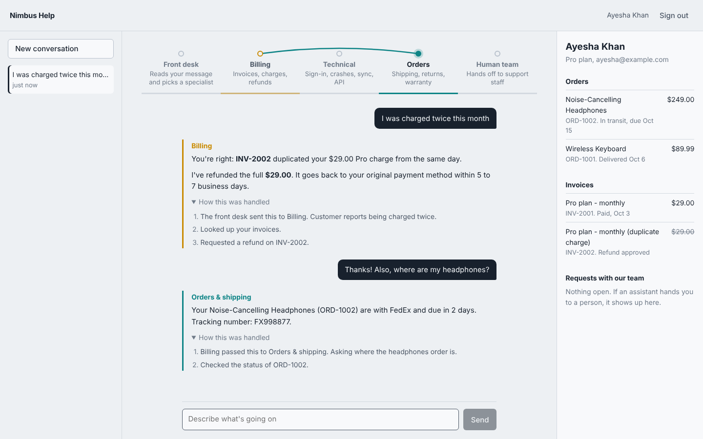

# Nimbus Help: a multi-agent customer support system

A customer writes in; a front-desk router hands them to the right AI specialist (billing, technical support, or orders), specialists pass conversations between themselves, and anything outside policy goes to human staff. Answers to "how does X work" questions are grounded in the help center through hybrid RAG with citations. Every action the agents take is enforced by business rules in code, written to an audit log, and visible to the customer as a plain-language trace.



**Stack:** Python 3.12, LangGraph, FastAPI, PostgreSQL 16+ with pgvector, SQLAlchemy 2 (async), Alembic, React 19 + TypeScript + Vite, Docker Compose, GitHub Actions.

## What's worth looking at

| | |
|---|---|
| **Agent orchestration** | Explicit LangGraph state machine: guard → triage → specialist ⇄ tools, with in-turn handoffs, sticky routing, a handoff cap and a tool-step cap that both fall back to humans. [`agents/graph.py`](backend/src/support/agents/graph.py) |
| **Policy lives in code** | Refund limits, refund/return windows and one-refund-per-invoice are pure functions enforced by transactional services with row locks. A manipulated model still can't refund another customer's invoice or exceed a limit. [`domain/policies.py`](backend/src/support/domain/policies.py) |
| **Hybrid RAG** | Markdown-aware chunking with heading paths, pgvector HNSW + Postgres full-text, fused with Reciprocal Rank Fusion, per-document diversity, idempotent fingerprinted ingestion, cited sources in replies. [`rag/`](backend/src/support/rag) |
| **Human in the loop** | Refunds over $50 become pending with an auto-opened ticket; staff approve or decline in the console; everything is audited. |
| **Guardrails** | PII (Luhn-validated cards, SSNs, IBANs) redacted before any model or log sees it; prompt-injection screening; retrieved docs fenced as untrusted data; identity taken only from the JWT, never from tool arguments. [`docs/security.md`](docs/security.md) |
| **Streaming** | Turns run as background tasks feeding Server-Sent Events, so a dropped connection doesn't lose a half-finished reply; 409 on concurrent turns; per-user rate limiting. |
| **Evaluation** | 17 behavioural agent scenarios (routing, tools, DB side effects, safety) + a 22-query retrieval benchmark (recall@3, MRR) + optional LLM judge. Runs in CI on prompt changes. [`evals/`](backend/evals) |
| **Engineering hygiene** | 74 backend tests on real Postgres (migrations included, 92% coverage), ruff + strict-ish mypy, 11 frontend tests, structured JSON logs with request ids, Prometheus metrics, health/readiness probes, RFC 7807 errors. |

## Architecture

```mermaid
flowchart LR
  subgraph Browser
    UI[React app<br/>chat + staff console]
  end
  subgraph API[FastAPI]
    Auth[JWT auth<br/>rate limit]
    Runner[Chat runner<br/>SSE stream]
    Admin[Staff endpoints]
  end
  subgraph Graph[LangGraph]
    G[guard<br/>PII + injection] --> E{entry}
    E -->|new topic| T[triage]
    E -->|sticky| S
    T --> S[specialist<br/>billing / technical / orders / escalation]
    S <--> Tools[tools]
    Tools -->|transfer_to_*| S
  end
  subgraph Services[Domain services]
    P[policies] --- B[billing / orders / tickets]
    B --- A[audit log]
  end
  subgraph PG[(PostgreSQL)]
    D[business tables]
    V[kb_chunks<br/>pgvector + tsvector]
    C[LangGraph checkpoints]
  end
  UI -- SSE / JSON --> Auth --> Runner --> Graph
  UI --> Admin --> Services
  Tools --> Services --> D
  Tools --> R[hybrid retriever] --> V
  Graph --> C
  S --> LLM[(Claude)]
  R --> EMB[(OpenAI embeddings)]
```

More detail, including the request lifecycle and data model: [`docs/architecture.md`](docs/architecture.md). Key decisions and the alternatives considered: [`docs/adr/`](docs/adr).

## Run it

**Docker (everything):**

```bash
cp .env.example .env        # add ANTHROPIC_API_KEY, OPENAI_API_KEY, SUPPORT_JWT_SECRET
docker compose up --build   # Postgres, migrations + seed + KB indexing, API, web
open http://localhost:8080
```

Sign in with a demo account from the login page (password `demo1234` for all):

| Account | Try |
|---|---|
| Ayesha (Pro) | "I was charged twice" → instant $29 refund; "where are my headphones?" → handoff to orders |
| Marcus (Basic) | "return my desk lamp" → refused, outside the 30-day window; "API gives 403" → plan explanation from the help center |
| Sofia (Enterprise) | "refund my last invoice" → $499 is over the limit, so it's pending with a ticket |
| Jordan (staff) | Approve Sofia's refund in the console and watch it update her account |

No OpenAI key? Set `SUPPORT_EMBEDDING_PROVIDER=hashing` for an offline, lexical-only index (fine for demos, weaker on paraphrases).

**Local development:**

```bash
make db install            # Postgres in Docker, Python + Node deps
cp .env.example backend/.env   # and set SUPPORT_DATABASE_URL to localhost
make setup                 # migrate, seed, index the knowledge base
make api                   # :8000, OpenAPI docs at /api/docs
make web                   # :5173, proxies /api
```

## Test and evaluate

```bash
make lint                  # ruff, ruff format, mypy, eslint, tsc
make test                  # pytest on Postgres (TEST_DB=...) + vitest
make evals                 # real-model agent + retrieval evals; resets the target DB
```

Tests never call an LLM: a scripted chat model drives the real graph, tools, database and retriever, so behaviour like "a fourth handoff in one turn escalates" or "a card number never reaches the model" is pinned down deterministically. The eval suite is the complement: the same kinds of assertions against real models, gated in CI by a minimum pass rate. Retrieval scores with the offline embedder are recall@3 91%, MRR 0.81; the misses are pure paraphrases ("send back" for "return"), which the semantic half of the hybrid retriever exists for.

## Project layout

```
backend/
  src/support/
    agents/        graph, tools, prompts, state
    api/           routes, SSE chat runner, auth deps, composition root
    domain/        enums, errors, pure policies, read models
    services/      billing, orders, tickets, customers, audit (transactional)
    rag/           chunking, embeddings, ingestion, hybrid retriever
    security/      PII redaction, injection scoring, JWT/passwords, rate limiting
    observability/ structured logging, Prometheus metrics
    evals/         eval checks and runner
    db/            models, session, seed
  alembic/         migrations
  knowledge_base/  help-center articles (markdown + front matter)
  evals/           agent and retrieval eval cases
  tests/           unit + integration (Postgres)
frontend/src/
  api/             typed client, SSE parser
  components/      Switchboard, Message, Composer, AccountPanel
  pages/           Login, Chat, Console
docs/              architecture, ADRs, security, screenshots
```

## Known limitations

These are deliberate scope cuts for a single-node deployment, each with a clear upgrade path:

- **Rate limiting and the one-turn-per-conversation guard are per process.** With several API replicas, move both to Redis (sorted-set limiter, `SET NX` lock) or a Postgres advisory lock.
- **Prompt-injection detection is heuristic.** It's a cheap first filter; the real boundary is that tools enforce authorization and policy in code. A classifier model would catch paraphrased attacks.
- **No reranker.** RRF output goes straight to the model. A cross-encoder (e.g. Cohere Rerank or a local BGE reranker) slots into `HybridRetriever.search`.
- **Tokens are kept in `sessionStorage`.** That's simple and expires with the tab, but an HttpOnly cookie with CSRF protection is the stronger choice for production.
- **The data model is a demo.** Orders, invoices and tickets would come from real systems (Shopify, Stripe, Zendesk) behind the same service interfaces.
