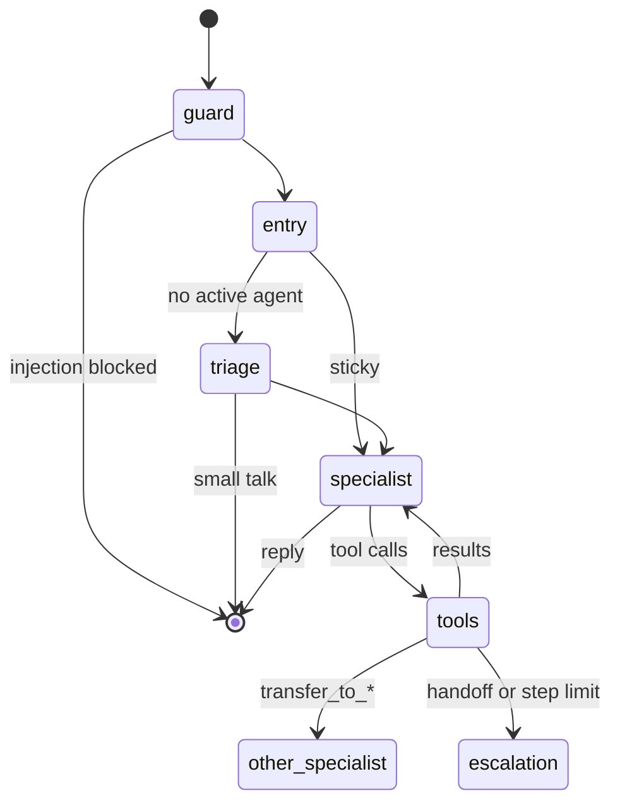
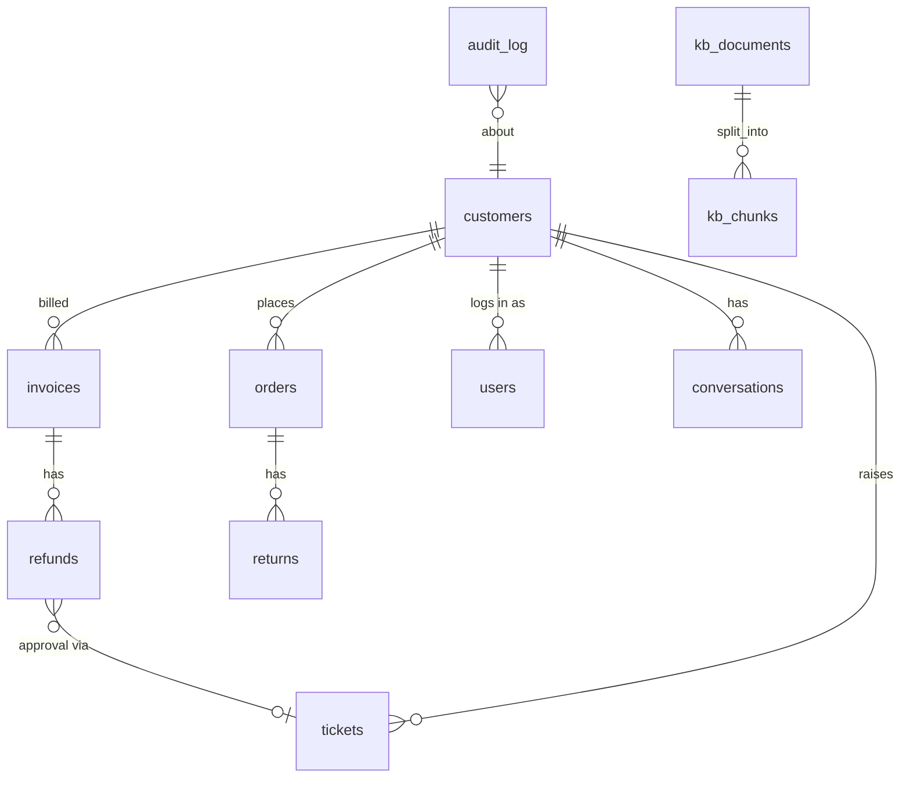

# Architecture

## Layers

```
api/        HTTP: auth, validation, streaming, error mapping. No business rules.
agents/     LangGraph: routing, handoffs, guardrails, tool adapters. No SQL.
services/   Use cases: one transaction each, ownership scoping, row locks, audit.
domain/     Pure rules and types: no I/O, no clock.
db/ rag/    Persistence and retrieval.
```

Dependencies point inward. Agents call services through tools; the API calls services directly for the staff console. Both paths share the same rules, so a refund approved through the console and one requested through chat are validated identically.

## Request lifecycle: one customer turn

1. `POST /api/v1/conversations/{id}/messages` with `Accept: text/event-stream`.
2. Auth decodes the JWT; the rate limiter checks the user; a short transaction verifies the conversation belongs to this customer.
3. `ChatRunner.start_turn` marks the conversation busy (409 if a turn is already running) and starts the graph in a background task that writes to a queue. The HTTP response streams from that queue, so a disconnect doesn't cancel the turn.
4. The graph runs with `configurable = {thread_id, conversation_id, customer_id}`. The customer id is the only identity the tools ever see.
   - **guard** redacts PII in the new message (replacing it in state by message id) and scores it for injection. Blatant attacks get a fixed refusal without any model call.
   - **entry** resets per-turn counters and routes to the active specialist, or to **triage** if none.
   - **triage** (small model, JSON-schema structured output) picks a specialist or answers small talk.
   - **specialist** (large model with tools bound) either replies, or calls tools. The **tools node** runs them, records trace events, and either loops back, hands off (`transfer_to_*`), or escalates when a limit trips.
5. Trace events are streamed live through LangGraph's `custom` stream mode and persisted for the turn; agent tokens stream through `messages` mode.
6. After the graph finishes, the runner reads the checkpointed state, emits the final `message` event (with cited sources), updates the conversation's title and active agent, and emits `done`.

## Agent graph



Each specialist has its own system prompt and tool set:

| Agent | Tools |
|---|---|
| billing | profile, list invoices, request refund, search help center |
| technical | profile, search help center |
| orders | profile, list orders, order status, start return, search help center |
| escalation | profile, create support ticket |

All specialists can transfer to every other specialist.

## Retrieval

```
query ─┬─ embed → pgvector HNSW (cosine) → top 20 ─┐
       └─ OR'd tsquery → GIN full-text (ts_rank_cd) → top 20 ─┴─ RRF (k=60) → ≤2 chunks/doc → top 4
```

Chunks are embedded with their heading path prepended ("Refund policy › How long refunds take"), which helps short chunks match. Results are returned to the model inside `<search_results>` with HTML-escaped content and an explicit note that they're data, not instructions. The tool's artifact carries title and URL for each source; the final reply keeps only the sources it actually cites.

Ingestion fingerprints each document over its content, chunker version, chunk sizes and embedding model. Unchanged documents cost nothing on re-run, so ingestion is safe in every deploy.

## Data model



- Money is `NUMERIC(10,2)` and `Decimal` end to end.
- Status columns are `VARCHAR` with `CHECK` constraints generated from Python enums (easier to migrate than native PG enums).
- `kb_chunks.tsv` is a generated `tsvector` column, so full-text search can't drift from content.
- Conversation messages live in LangGraph's Postgres checkpoint tables; `conversations` holds the metadata the UI lists.

## Observability

- **Logs:** structlog JSON with `request_id`, `user_id`, `conversation_id` bound per request; a processor redacts PII from every string field as a last line of defence.
- **Metrics** (`/metrics`): HTTP rate/latency by route template, turn latency and outcome, triage routes, handoffs, tool calls by outcome, guardrail trips, LLM tokens by agent, retrieval latency. Labels are bounded (never user ids or free text).
- **Tracing:** set `LANGSMITH_TRACING=true` to trace each turn, including every model and tool call.
- **Probes:** `/healthz` never touches dependencies; `/readyz` checks the database and that the knowledge base is indexed.
